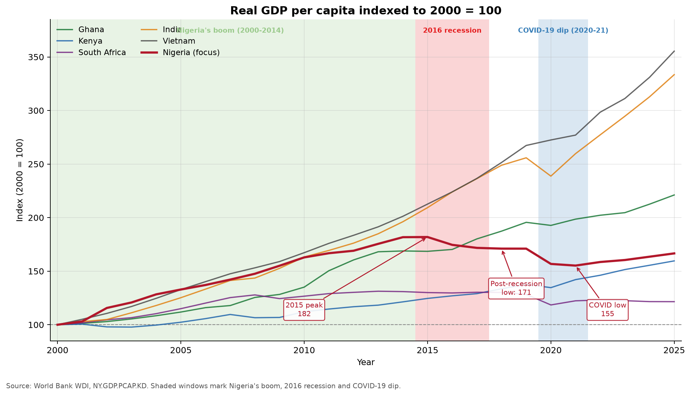
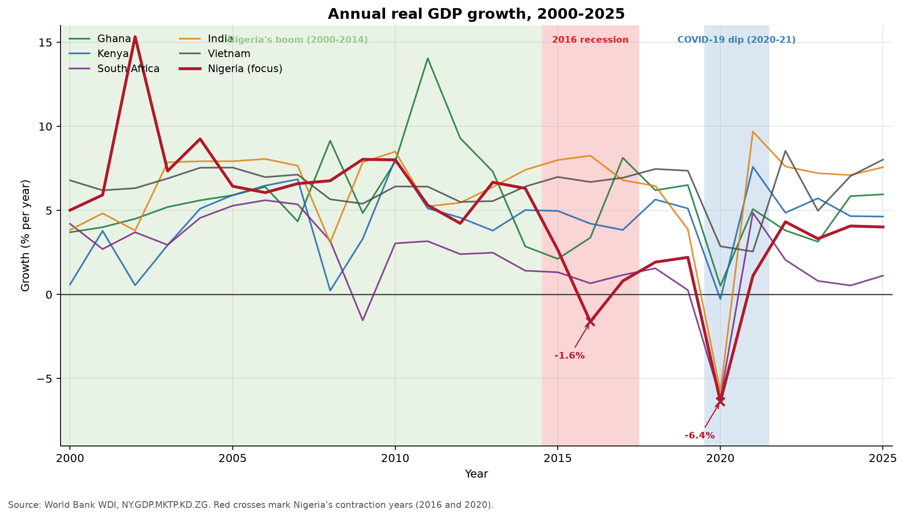
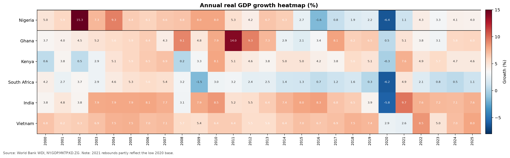
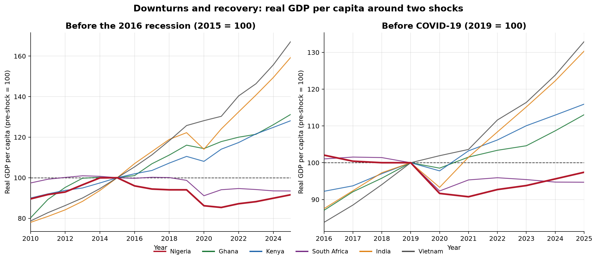
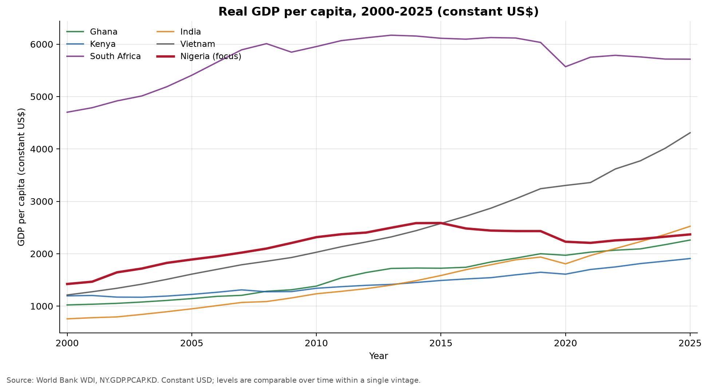
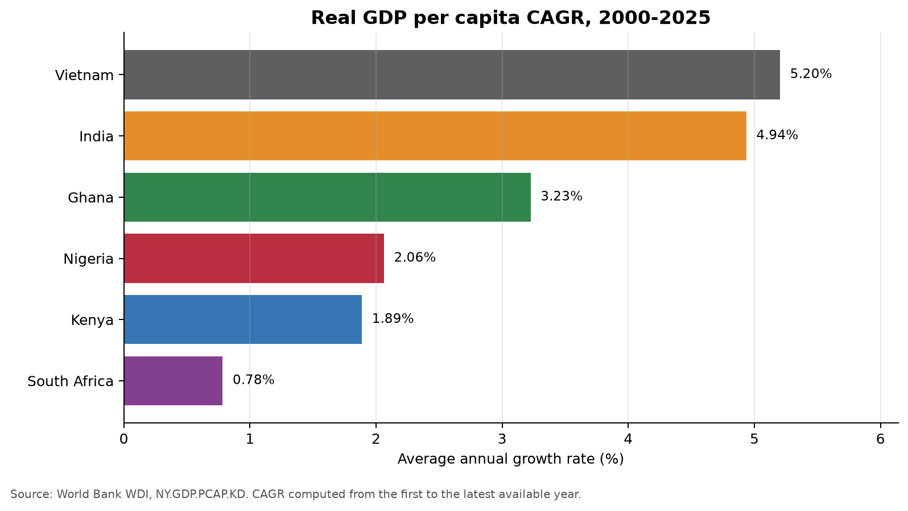

# Nigeria vs Peers — 25 Years of Growth (2000–2025)

A reproducible, API-driven comparison of Nigeria's economic performance against Ghana, Kenya,
South Africa, India and Vietnam, using real GDP per capita and annual real GDP growth from the
World Bank's World Development Indicators (WDI).

## Question

How has Nigeria's GDP per capita and real growth compared with Ghana, Kenya, South Africa, India
and Vietnam since 2000 — and what do the comparisons reveal about Nigeria's long-run trajectory,
its boom, the 2016 recession and the COVID-19 dip?

## Data

| Indicator | WDI code | Use |
| --- | --- | --- |
| GDP per capita (constant 2015 US$) | `NY.GDP.PCAP.KD` | Real output per person, indexed to 2000 = 100 |
| GDP growth (annual %) | `NY.GDP.MKTP.KD.ZG` | Annual real economic growth |

Countries: Nigeria (focus), Ghana, Kenya, South Africa, India, Vietnam. Period: 2000–2025.
Both series were pulled live from `https://api.worldbank.org/v2` (data vintage 2026-11-11).
The current pull has complete coverage: 156 country-year observations per indicator, no gaps.

## Quick start

```powershell
pip install -r requirements.txt
python run_analysis.py
```

To rebuild from the saved raw API responses without calling the API again:

```powershell
python run_analysis.py --skip-fetch
```

The pipeline runs in four steps: **fetch** → **build panel** → **charts** → **report**.

## Project structure

```
run_analysis.py                 End-to-end pipeline entry point
src/config.py                   Countries, indicators, paths, event windows
src/fetch_wdi.py                WDI API pulls and raw data export
src/build_panel.py              Cleaning, balanced panel, indexing, derived tables
src/visualize.py                Six comparative charts
src/report.py                   Generated analytical report (also embedded in README)

data/raw/                       Raw JSON responses + flattened long-form CSV
data/processed/                 Country-year panel, summary, event and data-quality tables
outputs/figures/                PNG charts
outputs/analytical_report.md    Full analytical report
```

### Deliverables

| Deliverable | File |
| --- | --- |
| Raw dataset | `data/raw/wdi_*.json`, `data/raw/wdi_raw_long.csv` |
| Cleaned country-year panel | `data/processed/country_year_panel.csv` |
| Indexed real GDP per capita | `gdp_pc_index_2000` column in the panel |
| Comparative visualisations | `outputs/figures/01`–`06_*.png` |
| Economic event analysis | `data/processed/events_by_country.csv`, report §5 |
| Analytical report | `outputs/analytical_report.md`, `README.md` |

## Headline findings

- Nigeria's real GDP per capita rose from **$1,422 (2000)** to **$2,369 (2025)** — a CAGR of
  **2.06%**, 4th of the six countries. Vietnam (5.20%) and India (4.94%) were far faster.
- The oil-led boom lifted Nigerian real GDP per capita **82% by 2014**, peaking in 2015, but by
  2025 it was still **8.4% below that peak**.
- Real GDP fell **1.6% in 2016** and **6.4% in 2020**; the per-capita losses persisted. Nigeria has
  recovered neither its 2015 nor its 2019 real GDP per capita level, while all five peers regained
  their 2015 level by 2017.
- Vietnam overtook Nigeria in 2016 and India in 2024; Ghana is within about 5% of Nigeria's level.
- **COVID base effects:** 2021 growth rates are inflated by the 2020 fall. On a 2019–2021
  compound basis Nigeria's real GDP per capita fell **4.7% a year**, the weakest in the group.

## Method notes

- Constant-dollar (`KD`) series are used throughout, never current USD. World Bank rebases its
  constant-dollar series periodically, so all data come from a single API vintage.
- The panel is balanced explicitly; missing years are logged in `data/processed/data_quality.csv`
  rather than silently interpolated.
- Event windows (boom 2000–2014, recession 2015–2017, COVID 2020–2021) are interpretive brackets
  for charts and comparisons, not a causal identification strategy.
- To neutralise COVID base effects the report also compares the *level* of real GDP per capita
  compounded from 2019 to 2021.

## Analytical report

_The full report is generated by `python run_analysis.py` and also saved as
[`outputs/analytical_report.md`](outputs/analytical_report.md)._

<!-- ANALYTICAL_REPORT:START -->
### Executive summary

- **Nigeria's real GDP per capita rose from $1,421.7 in 2000 to $2,368.5 in 2025** — a cumulative gain of 66.6% (CAGR 2.06% a year), ranking **4 of 6**. Vietnam (5.20%) and India (4.94%) grew much faster.
- **The oil-led boom lifted Nigeria's real GDP per capita by 81.7% between 2000 and 2014**, peaking at $2,585.7 in 2015 (index 181.9). By 2025 it was still **8.4% below that peak**.
- **Two shocks left lasting scars.** Real GDP fell 1.6% in 2016 and 6.4% in 2020; Nigeria has not regained either its 2015 or its 2019 real GDP per capita level by 2025.
- **Peer positions changed decisively.** Vietnam overtook Nigeria in real GDP per capita in 2016 and India in 2024; Ghana closed to within about 5% of Nigeria's 2025 level.
- **COVID base effects flatter the rebound.** Using 2019–2021 as a two-year window, Nigeria's real GDP per capita fell 4.7% a year — the weakest performance in the group — while the other peers were positive.

### 1. Data and method

- **Indicators:** `NY.GDP.PCAP.KD` — GDP per capita (constant 2015 US$) — and `NY.GDP.MKTP.KD.ZG` (annual real GDP growth). Both were pulled directly from the World Bank WDI API for Nigeria, Ghana, Kenya, South Africa, India and Vietnam, 2000–2025.
- **Panel:** the API responses were flattened, pivoted to a balanced country-year panel (156 rows = 6 countries × 26 years), and checked for missing observations (`data/processed/data_quality.csv`). This pull had **no missing years**.
- **Indexing:** each country's real GDP per capita was divided by its 2000 value and multiplied by 100. Index numbers compare *growth paths*, not income levels.
- **Long-run growth:** CAGR is computed on real GDP per capita from the first to the latest available year; it is not the average of annual growth rates.
- **Events:** shaded windows are analytical conventions — boom 2000–2014, 2016 recession 2015–2017, COVID-19 2020–2021. They describe timing, not causal attribution.
- **Base effects:** because the 2020 fall mechanically inflates 2021 growth, the report also uses the 2019–2021 compound rate of the *level* of real GDP per capita.

### 2. Long-run performance: levels and rankings

| Country | GDP pc 2000 (US$) | GDP pc 2025 (US$) | Cumulative change (%) | CAGR (%) | CAGR rank |
| --- | --- | --- | --- | --- | --- |
| Vietnam | 1,212.20 | 4,308.21 | 255.40 | 5.20 | 1 |
| India | 756.70 | 2,523.44 | 233.48 | 4.94 | 2 |
| Ghana | 1,022.28 | 2,260.58 | 121.13 | 3.23 | 3 |
| Nigeria | 1,421.68 | 2,368.54 | 66.60 | 2.06 | 4 |
| Kenya | 1,195.41 | 1,907.82 | 59.59 | 1.89 | 5 |
| South Africa | 4,700.88 | 5,713.12 | 21.53 | 0.78 | 6 |

In 2000 Nigeria was the second-richest country in the group in real GDP per capita ($1,421.7), behind South Africa but ahead of Ghana, Kenya, Vietnam and India. By 2025 Nigeria had slipped to rank 4 of 6: Vietnam, India and South Africa are now ahead, while Nigeria remains only narrowly ahead of Ghana and Kenya. The gap with the two Asian peers is the central finding of the comparison: Vietnam multiplied real GDP per capita 3.55× and India 3.33×, versus 1.67× for Nigeria.

**Relative position (peer GDP per capita ÷ Nigeria's)**

| Peer | Ratio in 2000 | First year above Nigeria | Ratio in 2025 |
| --- | --- | --- | --- |
| Ghana | 0.72 | Not by 2025 | 0.95 |
| Kenya | 0.84 | Not by 2025 | 0.81 |
| South Africa | 3.31 | Already above in 2000 | 2.41 |
| India | 0.53 | 2024 | 1.07 |
| Vietnam | 0.85 | 2016 | 1.82 |

Vietnam's crossover in 2016 coincided with Nigeria's recession, and India's in 2024 completes a two-decade convergence in which Nigeria moved from a clear lead over both to a position below them. Ghana started the period at roughly 72% of Nigeria's level and ended at about 95%, so Nigeria's regional lead is now thin.

### 3. Indexed real GDP per capita (2000 = 100)

| Country | 2000 | 2014 | 2015 | 2016 | 2019 | 2020 | 2021 | 2025 |
| --- | --- | --- | --- | --- | --- | --- | --- | --- |
| Nigeria | 100.00 | 181.73 | 181.88 | 174.57 | 171.03 | 156.76 | 155.22 | 166.60 |
| Ghana | 100.00 | 168.88 | 168.52 | 170.29 | 195.60 | 192.73 | 198.58 | 221.13 |
| Kenya | 100.00 | 121.35 | 124.57 | 126.98 | 137.67 | 134.63 | 142.12 | 159.59 |
| South Africa | 100.00 | 130.93 | 130.02 | 129.66 | 128.33 | 118.48 | 122.34 | 121.53 |
| India | 100.00 | 196.16 | 209.33 | 223.93 | 255.85 | 238.73 | 259.72 | 333.48 |
| Vietnam | 100.00 | 201.23 | 212.64 | 224.02 | 267.37 | 272.49 | 277.04 | 355.40 |

Nigeria's index climbed steadily to 181.9 in 2015, slipped to 171.0 by 2018, fell again to 155.2 in 2021, and has since recovered only to 166.6. That leaves the index 8.4% below its pre-recession high after roughly a decade. India and Vietnam, by contrast, reached about 333.5 and 355.4, with no comparable long-lasting interruption. South Africa's index barely moved, reflecting weak per-capita growth rather than crisis volatility.



### 4. Annual growth and volatility

| Country | Mean growth (%) | SD of growth (%) | Negative-growth years | Best year | Worst year |
| --- | --- | --- | --- | --- | --- |
| Vietnam | 6.39 | 1.37 | 0 | 2022 (8.5%) | 2021 (2.6%) |
| India | 6.25 | 2.98 | 1 | 2021 (9.7%) | 2020 (-5.8%) |
| Ghana | 5.60 | 2.71 | 0 | 2011 (14.0%) | 2020 (0.5%) |
| Nigeria | 4.76 | 3.98 | 2 | 2002 (15.3%) | 2020 (-6.4%) |
| Kenya | 4.36 | 2.14 | 1 | 2010 (8.1%) | 2020 (-0.3%) |
| South Africa | 2.18 | 2.47 | 2 | 2006 (5.6%) | 2020 (-6.2%) |

Nigeria records the highest growth volatility in the group (standard deviation 3.98 percentage points) despite a middling average rate. Its best year was 2002 (15.3%) during the boom; its worst was 2020 (-6.4%). Vietnam and India combined high average growth with markedly lower volatility, while South Africa had low growth *and* two contraction years.





### 5. Event analysis: Nigeria against its peers

#### 5.1 The boom (2000–2014)

Nigeria's real GDP per capita rose 81.7% over the boom window, an average of 4.36% a year; real GDP growth averaged 7.15%. This was a strong expansion in level terms but not an exceptional one: over the same years Vietnam gained 101.2% and India 96.2%, both starting from much lower bases.

#### 5.2 The 2016 recession

Nigeria's real GDP fell 1.6% in 2016. The per-capita effect was larger and more persistent: real GDP per capita fell from $2,585.7 in 2015 to $2,441.7 in 2017, a 5.6% decline, and had still not surpassed the 2015 level by 2025. Every other country in the sample had regained its 2015 real GDP per capita by 2017 (South Africa in 2017, the rest in 2016).

#### 5.3 COVID-19 dip and base effects

Nigeria's real GDP fell 6.4% in 2020 and real GDP per capita fell another 1.0% to $2,206.7 by 2021 — the 2021 headline growth rate of 1.1% was positive, but population growth meant average output per person still declined. India, South Africa and Nigeria all contracted sharply in 2020; Ghana and Kenya were nearly unaffected and Vietnam still grew.

| Country | 2020 growth (%) | 2021 growth (%) | 2022 growth (%) | 2019-21 GDP pc CAGR (%) |
| --- | --- | --- | --- | --- |
| Nigeria | -6.37 | 1.11 | 4.32 | -4.74 |
| Ghana | 0.51 | 5.08 | 3.80 | 0.76 |
| Kenya | -0.27 | 7.59 | 4.86 | 1.60 |
| South Africa | -6.17 | 4.86 | 2.06 | -2.36 |
| India | -5.78 | 9.69 | 7.61 | 0.75 |
| Vietnam | 2.87 | 2.55 | 8.54 | 1.79 |

The 2021 growth column overstates the strength of the recovery wherever 2020 was deep: it is measured against a depressed base. The final column strips that mechanical effect out by compounding the *level* from 2019 to 2021. On that basis Nigeria (-4.7% a year) and South Africa did worse than the rest of the group, while Vietnam, Kenya, India and Ghana still gained ground per person.

#### 5.4 Recovery comparison

| Country | 2015 GDP pc | Year regained 2015 level | 2019 GDP pc | Year regained 2019 level | 2025 vs 2019 (%) |
| --- | --- | --- | --- | --- | --- |
| Nigeria | 2,585.73 | Not by 2025 | 2,431.54 | Not by 2025 | -2.59 |
| Ghana | 1,722.77 | 2016 | 1,999.55 | 2021 | 13.05 |
| Kenya | 1,489.12 | 2016 | 1,645.71 | 2021 | 15.93 |
| South Africa | 6,112.27 | 2017 | 6,032.83 | Not by 2025 | -5.30 |
| India | 1,584.00 | 2016 | 1,936.03 | 2021 | 30.34 |
| Vietnam | 2,577.57 | 2016 | 3,241.08 | 2020 | 32.93 |

Nigeria is the only economy in the sample that has recovered neither its pre-2016 nor its pre-COVID real GDP per capita level. South Africa also remains below its 2019 level, but its downturn was shallower and its starting level far higher. Nigeria's 2022–2025 rebound of roughly 4% a year has not been enough to close the cumulative losses of the two shocks.



### 6. Answers to the specific research questions

**Q1. How has real GDP per capita evolved since 2000?** It rose from $1,421.7 to $2,368.5 in Nigeria, but with two long plateaus after 2015 and 2019 rather than a smooth upward path.

**Q2. Strongest and weakest growth in real GDP per capita?** Vietnam (5.20% CAGR) and India (4.94%) were strongest; South Africa (0.78%) and Kenya (1.89%) were weakest, with Nigeria (2.06%) in fourth place.

**Q3. How did Nigeria's annual growth compare?** Nigeria's mean annual growth (4.76%) was close to the group average but the most volatile; it had only two contraction years, yet both were deep and long-lasting in per-capita terms.

**Q4. Effects of the boom, 2016 recession and COVID-19?** The boom added 81.7% to real GDP per capita by 2014; the 2016 shock removed 5.6% by 2017; COVID cut real GDP per capita 8.3% in 2020 and a further 1.0% in 2021.

**Q5. How did recovery compare?** All five peers regained their 2015 level by 2017 and most regained their 2019 level by 2021. Nigeria regained neither by 2025.

**Q6. Sustained improvements in average output per person?** Only partly. The 2000–2014 expansion was substantial, but a decade after the peak real GDP per capita remained 8.4% lower, and growth since 2022 has merely repaired part of the COVID loss.

**Q7. How did Nigeria's relative position change?** It fell from second to fourth in the group by real GDP per capita: Vietnam passed it in 2016, India in 2024, and Ghana narrowed the gap to about 5%.

### 7. Caveats and limitations

- **Constant, not current, USD.** `NY.GDP.PCAP.KD` (GDP per capita (constant 2015 US$)) is inflation-adjusted against a fixed US-dollar base and is appropriate for comparing real growth over time. World Bank rebases the constant-dollar series periodically; all numbers here come from one API vintage and should not be mixed with another vintage or with current-USD levels.
- **Per capita ≠ distribution.** GDP per capita says nothing about inequality, poverty or welfare. Rapid population growth can produce falling per-capita output even when total GDP grows (Nigeria in 2021).
- **Base effects.** Annual growth for 2021 is mechanically distorted by the 2020 fall; the 2019–2021 compound rates and the indexed levels are the safer comparison.
- **Annual frequency and event windows.** Shaded periods are interpretive, not a formal causal design; quarterly data would date the turning points more precisely.
- **Coverage.** This vintage has complete 2000–2025 coverage for all six countries and no missing observations, so no interpolation was required.

### 8. Deliverables and reproduction

| File | Description |
| --- | --- |
| `data/raw/wdi_*.json`, `data/raw/wdi_raw_long.csv` | Raw API responses and flattened long data |
| `data/processed/country_year_panel.csv` | Balanced country-year panel with index and YoY per-capita change |
| `data/processed/summary_by_country.csv`, `events.csv`, `events_by_country.csv`, `data_quality.csv` | Derived tables |
| `outputs/figures/*.png` | Six comparative visualisations |
| `outputs/analytical_report.md` | This report |
| `run_analysis.py` | End-to-end pipeline: `python run_analysis.py` |




<!-- ANALYTICAL_REPORT:END -->
